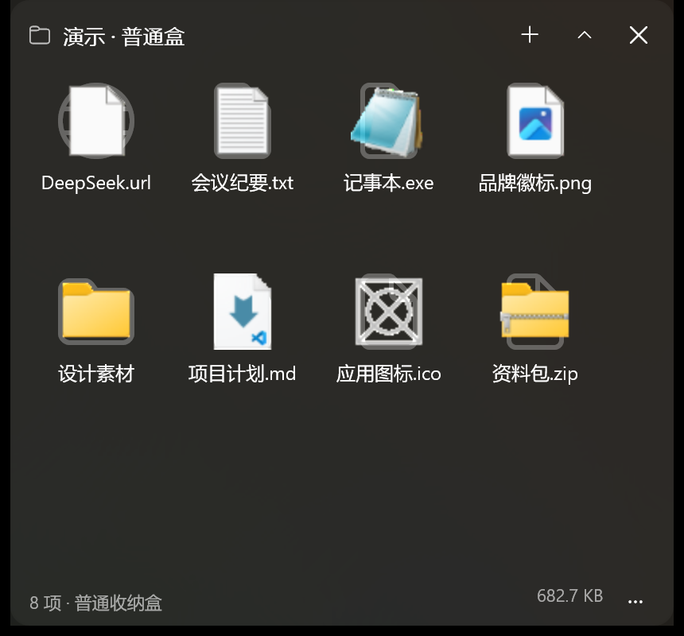
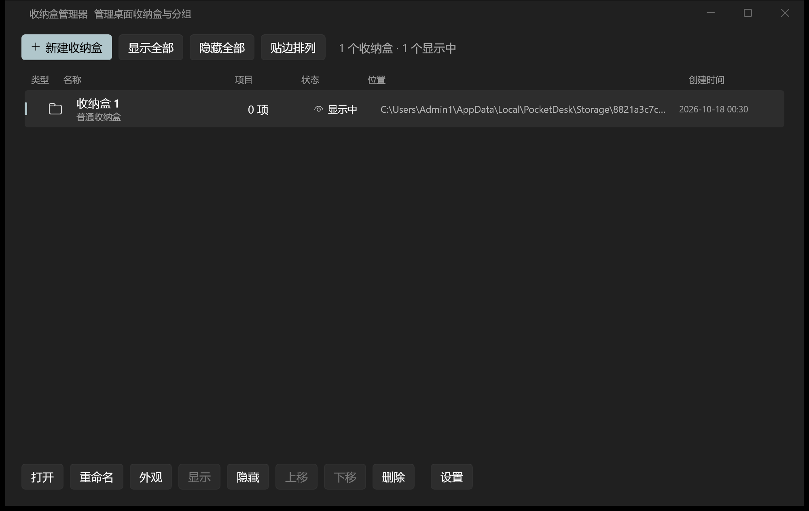
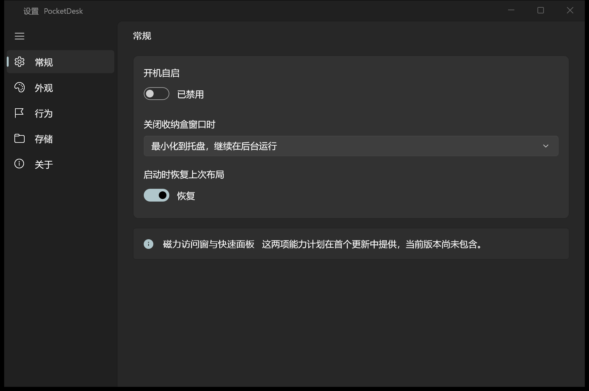

# PocketDesk

桌面上的原生收纳层，而不是另一个文件管理器。基于 **WinUI 3 + Windows App SDK + .NET 10 + SQLite** 实现。

当前版本：**1.1.0**（2026-10）



## 1.1.0 更新

- 材质新增 **全透**：透明背景 + 35% 半透明圆角边框，鼠标仍可正常点击、拖拽和右键
- 材质选项：跟随全局 / Mica / 亚克力 / 纯色 / 全透；修复全局材质对已有收纳盒不生效的问题，点击“把默认外观应用到所有收纳盒”会清除单盒材质/主题覆盖
- 网格视图改为 **GridView**，支持整块图标拖拽调整顺序（Windows 11 开始菜单磁贴同类控件）
- 圆角、边缘白缝重构：原生边框并入客户区，移除自绘第二层边框，避免一个角两层圆角和黑线
- 浅色模式修正：Mica/Acrylic 使用浅色半透明遮罩，纯色回退使用主题背景色
- 单击标题文字直接重命名收纳盒
- 移除边框粗细/颜色设置（统一为全透材质下的半透明边框）

## 当前状态

已实现 PRD V1.1 的 **MVP（P0）主体**，并在 Windows 11 ARM64（200% DPI）与 x64 上完成手工与自动化验证：

- 普通 / 映射 / 目标三种收纳盒（目标盒为 P1 基础能力）
- 拖入、拖出、跨盒拖放、粘贴、粘贴路径收纳
- 同名冲突（保留两者 / 替换 / 跳过 / 取消批量）、大文件确认
- 普通盒真实移动 + journal 崩溃恢复 + 原位还原（失败回退桌面并加 `restored`）
- 映射盒只存引用，重命名会同步源文件（AC-02）
- 无边框 / Mica / 亚克力 / 纯色 / 全透，跟随明暗主题与系统强调色
- 桌面层行为：**不占任务栏、不进 Alt+Tab、停靠在桌面之上/普通窗口之下**；Win+D 时临时浮起，不被桌面盖住，结束后恢复停靠
- 窗口保持普通激活方式；为兼容系统材质，不再使用 `WS_EX_NOACTIVATE`，点击收纳盒会正常获得焦点
- 卷起、位置/尺寸记忆、多显示器校验
- 多选、框选（在图标区拖拽空白）、右键菜单、批量重命名（前缀 + 序号）、排序（名称自然排序/类型/修改时间/添加时间/自定义，自定义支持上移/下移/拖拽图标调整顺序）
- 逐盒外观（圆角/透明度/图标大小/列数/文件名行数/网格或列表）+ 命名外观预设（保存/应用/删除）
- 系统图标提取（`IShellItemImageFactory`）：高 DPI 按 **256px Jumbo**、低 DPI 按 48px 物理像素提取；图标加载成功后自动隐藏占位层，避免发糊和叠加
- 拖入、粘贴后列表即时刷新（`ObservableCollection`），无需切换视图或手动刷新
- 拖出到资源管理器已做真实端到端验证（合成鼠标拖拽，复制到目标文件夹）
- 支持键盘：`Tab`/`Shift+Tab` 在图标间移动、`Enter` 打开、`F2` 重命名、`Delete` 删除、`Ctrl+A` 全选；图标暴露 `AutomationProperties.Name`
- 高对比度：检测到系统高对比度时强制纯色背景、禁用 Mica/Acrylic，并跟随系统主题
- 托盘菜单、开机自启、单实例、关闭到托盘、撤销删除（Toast/InfoBar）；托盘命令在菜单关闭后投递到 UI 队列；“新建收纳盒”直接创建默认命名收纳盒，不再弹模态框；Explorer 重启后自动恢复托盘图标
- 右键“背景透明度”快速预设 20%–100%，外观对话框内仍有背景不透明度滑条
- 收纳盒管理器：创建/重命名/复制（仅配置）/显示隐藏/排序/贴边排列/分组筛选，按分组设置
- 右键“创建快捷方式”：在桌面生成 `.lnk`（文件/文件夹）或 `.url`（网址）
- 统一设置（常规/外观/行为/存储/关于）、诊断日志导出
- SQLite schema 版本 + 迁移前自动备份（保留 3 份）

尚未实现（详见“已知限制”）：磁力访问窗、快速面板、导入导出/全量备份、首次启动向导、中英文资源化、Native AOT。




## 构建与运行

要求：Windows 10 1809+、.NET 10 SDK。

```powershell
cd PocketDesk
dotnet build -p:Platform=x64
.\bin\x64\Debug\net10.0-windows10.0.26100.0\win-x64\PocketDesk.exe

# ARM64 构建
dotnet build -p:Platform=ARM64
```

- 项目已启用 **Windows App SDK 自包含**（`WindowsAppSDKSelfContained=true`），无需预装 Windows App Runtime。
- Debug 为框架依赖（需要 .NET 10 桌面运行时）；Release 会同时自包含 .NET 运行时：
  ```powershell
  dotnet publish -c Release -p:Platform=x64
  # 输出：bin\Release\net10.0-windows10.0.26100.0\win-x64\publish
  ```
- 当前采用未打包（`WindowsPackageType=None`）交付，数据写入真实的 `%LOCALAPPDATA%\PocketDesk`，不受 MSIX 文件系统虚拟化影响。后续如需 MSIX，建议单独建立打包工程。

## 安装包

`..\Pack\` 提供两个架构的 MSI 安装包：

| 文件 | 适用平台 |
|---|---|
| `PocketDesk-1.1.0-ARM64.msi` | Windows on ARM（原生） |
| `PocketDesk-1.1.0-x64.msi` | 64 位 Intel/AMD |

- MSI 带中文安装向导：欢迎 → 许可协议 → 自定义安装（功能选择） → 安装 → 完成。
- “自定义安装”中可勾选/取消 **桌面快捷方式**；开始菜单快捷方式始终创建。
- 默认安装到 `%LOCALAPPDATA%\Programs\PocketDesk`，安装无需管理员权限，也不会弹出 cmd 窗口。
- 卸载默认保留 `%LOCALAPPDATA%\PocketDesk` 数据目录，并调用应用清理开机自启项。
- 安装包未做代码签名，SmartScreen 会提示，需“更多信息 → 仍要运行”。
- MSI 脚本：[installer/PocketDesk.wxs](installer/PocketDesk.wxs)（WiX 5；WiX 7 需接受 OSMF 协议故未使用）
- 中文界面资源：[installer/WixUI_zh-CN.wxl](installer/WixUI_zh-CN.wxl)；许可页：[installer/License.rtf](installer/License.rtf)

```powershell
dotnet publish -c Release -p:Platform=ARM64
dotnet publish -c Release -p:Platform=x64

wix build -arch arm64 -ext WixToolset.UI.wixext `
  -loc installer\WixUI_zh-CN.wxl `
  -d PublishDir=bin\Release\net10.0-windows10.0.26100.0\win-arm64\publish `
  -d LicenseFile=installer\License.rtf `
  -o ..\Pack\PocketDesk-1.1.0-ARM64.msi installer\PocketDesk.wxs
```

> 为了让 MSI 以当前用户安装，构建后把 MSI Summary Information 的 Word Count 提权位（0x8）清零；否则 Windows Installer 会按 per-machine 处理。

## 首次使用

启动后打开 **收纳盒管理器** → “新建收纳盒”：

| 类型 | 行为 |
|---|---|
| 普通收纳盒 | 文件真实移入 `%LOCALAPPDATA%\PocketDesk\Storage\<盒ID>`；删除项目/收纳盒时自动还原到原位置 |
| 映射收纳盒 | 只保存绝对路径，绝不移动、复制或修改源文件；也支持“此电脑 / 控制面板 / 回收站”等 shell 位置引用 |
| 目标收纳盒 | 绑定一个现有文件夹，内容双向显示（基础同步） |

把文件从资源管理器/桌面拖进盒子即可；右键空白处可排序、切换视图、新建文件夹、粘贴路径。右键标题栏或底部“…”可以打开外观、置顶、卷起等。

> 收纳盒默认位于桌面层：不占任务栏、不进 Alt+Tab。点击时短暂浮起以便操作，失去焦点后自动沉底。需要常驻最前时在菜单中勾选“始终置顶”。

## 数据与文件安全

```
%LOCALAPPDATA%\PocketDesk\
├─ pocketdesk.db          SQLite（WAL）
├─ Storage\<盒ID>\        普通盒实际文件
├─ backup\                迁移前数据库备份（最近 3 份）
├─ Logs\                  运行日志（导出时脱敏）
└─ Export\                诊断日志 zip
```

- 所有真实移动先写 `journal`（PENDING），移动完成后标记 DONE；启动时自动收敛半移动并清理 `*.pocketdesk.tmp`。
- 普通盒删除 = 还原到 `sourcePath`；原目录不存在或同名时回退桌面并加 ` (restored)`。
- 映射盒的所有文件操作都直接作用于源文件（重命名）或不改动源文件（删除引用）。
- 普通盒拒绝：UNC 网络路径、OneDrive 云占位文件、回收站路径、超过 259 字符的路径。
- 符号链接/目录联接只保存引用，不跟随、不复制。
- 不收集文件内容或路径；诊断日志导出时会把用户目录替换为占位符。

## 已验证

- 无界面自测 27/27：导入、原位还原、撤销、重命名、批量重命名、映射盒、同名冲突、自定义排序、外观预设、快捷方式、复制收纳盒、分组、journal 恢复、删除收纳盒
- 拖入自动刷新：演示盒拖入文件后列表从 8 项立即变为 9 项，无需切换视图
- 高 DPI 图标：200% 缩放下按 256px 提取，图标清晰；占位层在加载后隐藏，无半透明叠加
- 框选：演示盒 8 项全部框选成功（UIA `SelectionPattern` 读取选中数为 8）
- 真实鼠标拖拽：从收纳盒拖 `百合.png` 到资源管理器 `DragOutTest` 文件夹，成功生成副本，源文件保持在盒中
- 任务栏 UIA 枚举中不存在 PocketDesk 按钮；`WS_EX_TOOLWINDOW` + `IsShownInSwitchers=false`
- 窗口中心点命中测试属于其他进程 → 失焦后确实沉在普通窗口下方
- 开机自启：设置中开启后 HKCU Run 写入带引号的 exe 路径，关闭后删除
- 托盘：`Shell_NotifyIconGetRect` 确认图标注册；左键显示全部；Win11 溢出面板中真实右键打开原生菜单，选择“显示全部收纳盒”后隐藏的收纳盒恢复显示
- 托盘“新建收纳盒”：菜单命令延迟到 DispatcherQueue 执行，管理器正常打开，进程保持响应
- 背景透明度：右键菜单 20%/40%/60%/70%/80%/90%/100% 预设可即时预览并保存
- 单实例：二次启动进程退出并唤醒已有实例；关闭到托盘、托盘退出、200% DPI、Release 自包含发布均通过
- MSI：ARM64 包静默安装 → 安装目录含 `PocketDesk.pri`/XBF/Assets → GUI 正常打开；卸载保留数据并清理 HKCU 自启项；安装向导可正常启动（Welcome 页），许可/安装目录页由 `WixUI_InstallDir` 提供
- Release 自包含发布（含 .NET 运行时与 Windows App SDK）通过同一套 27 项自测
- x64 MSI 已构建；x86 安装包已按需求移除

## 开发验证

无界面自测（27 项断言，覆盖导入、原位还原、撤销、重命名、批量重命名、映射盒、同名冲突、自定义排序、外观预设、快捷方式、复制收纳盒、分组、journal 恢复、删除收纳盒）：

```powershell
$testRoot = "$PWD\.selftest"
$env:POCKETDESK_HOME = $testRoot
.\bin\x64\Debug\net10.0-windows10.0.26100.0\win-x64\PocketDesk.exe --selftest
Get-Content "$testRoot\selftest-report.txt"
```

`POCKETDESK_HOME` 可把数据根目录指向任意隔离位置（测试/便携模式）。`--demo` 会创建两个演示收纳盒，便于截图与手工验收。

## 架构

```
Models.cs                 领域模型（Box / BoxItem / Journal / Settings / Appearance）
Data/
  Database.cs             SQLite 初始化、schema 版本、迁移备份
  Repositories.cs         Box / Item / Journal / Settings 仓储
Services/
  FileSystemService.cs    journal 移动、跨卷先复制校验后删除、原位还原、启动恢复
  ImportService.cs        收纳规则、冲突/云文件/UNC/链接/大文件策略
  BoxService.cs           收纳盒与收纳项 CRUD、排序、删除/撤销、目标盒同步
  IconService.cs          Shell 图标提取（48/256 物理像素）+ SoftwareBitmap + 缓存
  AccessibilityService.cs 高对比度/主题检测
  AppearancePresetService.cs 外观预设
  UninstallService.cs     卸载时的还原/保留/删除数据策略
  TrayIcon.cs             Shell_NotifyIcon 托盘与原生菜单
  SingleInstanceService.cs Mutex + 命名管道（show/manager/settings/hide/exit）
  WindowManager.cs        窗口生命周期、贴边排列、退出清理
Views/
  BoxWindow.xaml          无边框收纳盒（拖拽、多选、右键、卷起、桌面层）
  BoxManagerWindow.xaml   收纳盒管理器
  SettingsWindow.xaml     NavigationView 设置
  Dialogs.cs              ContentDialog（冲突/重命名/外观/确认）
installer/
  PocketDesk.wxs          WiX 5 MSI 定义（向导、快捷方式、卸载清理）
  License.rtf             安装向导许可页
```

## 已知限制 / 后续

- **磁力访问窗、快速面板**未实现（PRD 已列为 P1）。
- **导入/导出/完整备份**未实现（P1）；目前仅有诊断日志导出。
- **Native AOT** 暂未打通。项目已预留 `dotnet publish -c Release -r win-x64 -p:AotPublish=true` 开关，但当前 `WinAppSDK 2.5.1 + WinUI 2.3.9` 组合下，XAML 编译器在 Pass1 即报 `WMC1007 Cannot resolve metadata for WinUI types`；`WindowsAppSDKSelfContained` 开/关、`PublishTrimmed` 开/关、显式 CsWinRT 2.3.1、`net8.0-windows` 与 `net10.0-windows` 目标均复现。Release 仍为自包含、不裁剪；需要更换到 PRD 基线的 WinAppSDK 1.6/1.7 + .NET 8 工具链后再验证 AOT。
- **MSIX** 未做；当前提供 MSI 安装包（ARM64 / x64），尚未做代码签名，SmartScreen 会提示未知发布者。
- MSI 卸载默认**保留数据**并清理自启项，不提供 EXE 安装器那种“还原/保留/删除”三选一；需要在卸载前还原普通盒文件时，请先在应用内删除对应收纳盒/收纳项。
- MSI 使用功能树选择“桌面快捷方式”，不提供安装路径页；安装目录固定为 `%LOCALAPPDATA%\Programs\PocketDesk`。
- 背景透明度作用于 Mica/Acrylic 的遮罩；纯色材质不透明；需要完全透出桌面时请选择“全透”。
- 材质使用系统 Mica / DesktopAcrylicBackdrop；全透使用透明 SystemBackdrop + DWM 客户区延伸；不再做壁纸截屏，拖动与缩放保持流畅。
- x86 安装包已按需求移除，仅保留 ARM64 与 x64。
- 目标盒同步为单向补充（外部新增会显示，外部删除不会自动移除记录），完整双向同步待完善。
- 自定义排序支持菜单上移/下移；网格视图使用 GridView 的整块磁贴拖拽重排。
- 框选暂不支持滚动时自动扩展选择范围；虚拟化到屏幕外的项目需滚动后重新框选。
- 外观预设已支持保存/应用/删除，但尚无独立的预设管理窗口。
- 多选批量重命名已实现，但撤销仅覆盖删除操作。
- 开机自启已验证，但“启动时是否自动恢复布局”的端到端组合尚未单独回归。
- 界面文案暂为内联中文，`.resw` 资源化与英文版待补。
- 提权进程拖入（UIPI）尚未做 Toast 提示；已提供“粘贴路径收纳”兜底。
- 空闲内存尚未达到 PRD 的 ≤80 MB 目标（Release 实测约 150–170 MB）：WinUI 3 基线加自包含运行时占用较高，后续需通过 AOT/裁剪、图标缓存上限与窗口按需创建来优化。

## 第三方组件

Windows App SDK（MIT）、.NET（MIT）、SQLite / SQLitePCLRaw（Public Domain / Apache-2.0）、Microsoft.Data.Sqlite（MIT）。
